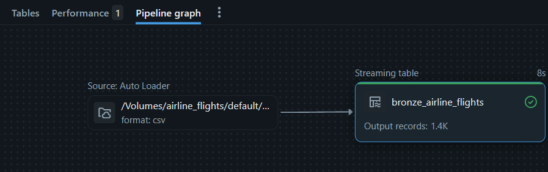
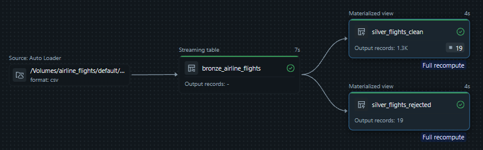
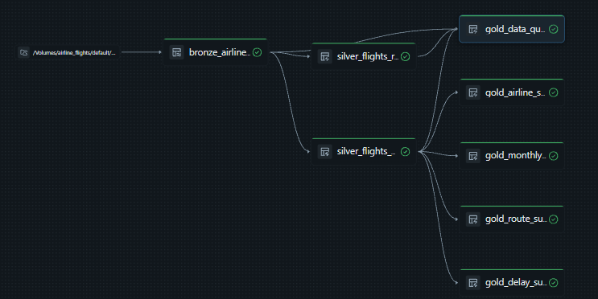
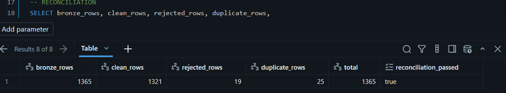
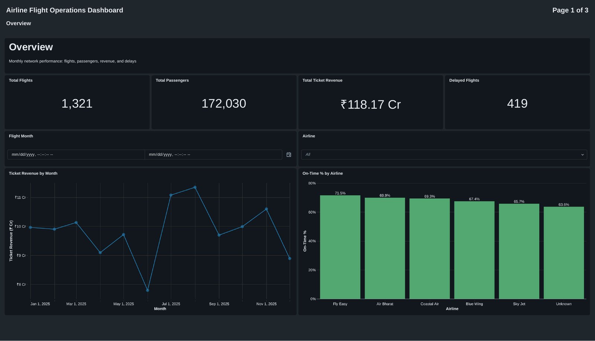
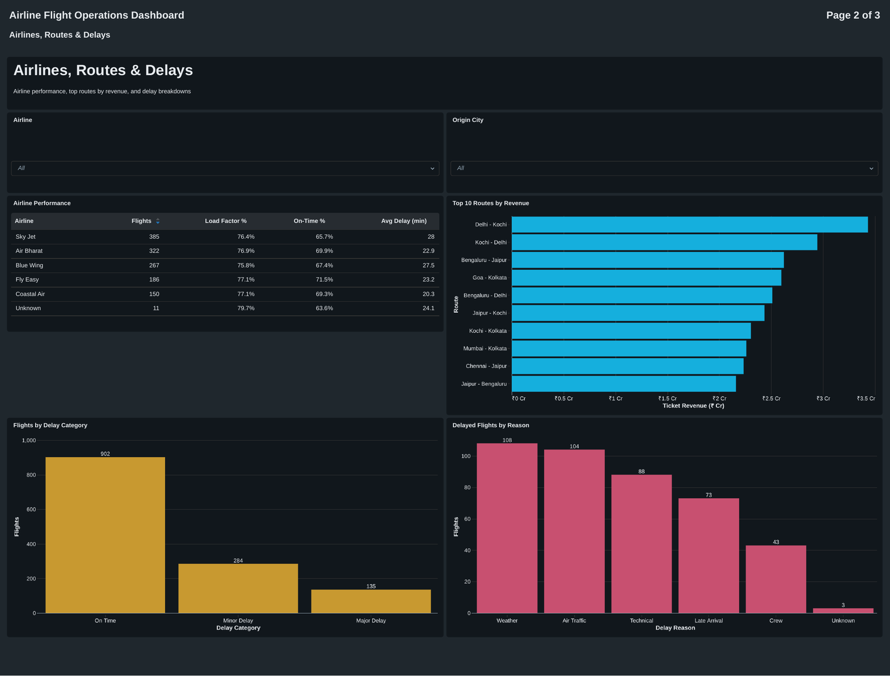
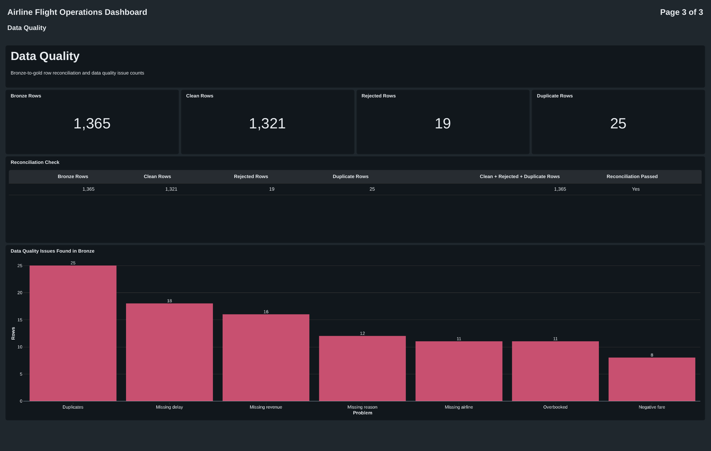

# Airline Flight Operations Analytics Platform

An end-to-end ETL pipeline I built during my Data Engineering Internship, using **SQL** and **Lakeflow Spark Declarative Pipelines** on **Databricks Free Edition**. It follows the Medallion Architecture (Bronze, Silver, Gold) and ends with a 3-page Databricks AI/BI dashboard.

## 1. Project Overview

An airline operations team exports every domestic flight to a CSV file, and the file has common data problems. I built a repeatable pipeline that keeps the raw file, cleans it step by step, creates business-ready summary tables, proves that no row was lost, and shows the results in a dashboard.

**Dataset:** `airline_flights_raw.csv`, a synthetic dataset (made up for learning) with 1,365 rows and 20 columns covering domestic flights in 2025.

**Problems I found and fixed:**
- Duplicate flights
- Extra spaces and mixed capital letters in airline and city names
- Blank airline, delay minutes, delay reason and ticket revenue
- Flights with more passengers than seats
- Negative average fares

## 2. Architecture

```
airline_flights_raw.csv  (Unity Catalog Volume)
          |
   BRONZE   bronze_airline_flights        raw data + source_file + loaded_at
          |
   SILVER   silver_flights_clean          cleaned data + delay_category
            silver_flights_rejected       bad rows + reject_reason
          |
   GOLD     gold_monthly_flights
            gold_airline_summary
            gold_route_summary
            gold_delay_summary
            gold_data_quality             row counts + reconciliation
          |
   Databricks AI/BI Dashboard (3 pages)
```

| Layer | What I did | Result |
|---|---|---|
| Bronze | Loaded the CSV as it is with Auto Loader and added the file name and load time | 1 streaming table |
| Silver | Removed duplicates, fixed text, filled blanks, added `delay_category`, and moved impossible rows to a rejected table | 1 clean table + 1 rejected table |
| Gold | Grouped the clean data by month, airline, route and delay, and calculated load factor and on-time % | 4 summary tables + 1 data quality table |
| Dashboard | Built 3 pages on the Gold tables only | 1 dashboard |

## 3. Repository Structure

```
airline-flight-operations-etl/
├── README.md
├── data/
│   └── airline_flights_raw.csv
├── pipeline/
│   ├── 01_bronze.sql
│   ├── 02_silver.sql
│   ├── 03_gold.sql
│   └── 04_data_quality.sql
├── dashboard/
│   └── Airline_Flight_Operations_Dashboard.pdf
├── docs/
│   ├── cleaning_rules.md
│   └── review_answers.md
└── screenshots/
```

## 4. How I Set It Up

1. I signed up for Databricks Free Edition and used the catalog `airline_flights` with the schema `default`.
2. I created a managed volume named `raw_files`, which gives the path `/Volumes/airline_flights/default/raw_files/`.
3. I uploaded `airline_flights_raw.csv` into the volume.
4. I checked the upload with this query, which returned 1,365 rows:

```sql
SELECT COUNT(*) FROM read_files('/Volumes/airline_flights/default/raw_files/',
  format => 'csv', header => true);
```

5. I created an ETL pipeline named `airline_flights_pipeline` (Jobs & Pipelines, then Create, then ETL pipeline) with the default catalog `airline_flights`, the default schema `default`, and SQL as the language.
6. I added the four SQL files from the `pipeline/` folder to the pipeline's `transformations` folder, inside `Bronze`, `Silver` and `Gold` subfolders.
7. I clicked **Run pipeline**. Databricks works out the order from the table dependencies, so the whole project runs with one click and gives the same result every time.

To reproduce this, repeat the same steps with your own catalog and schema, and change the volume path in `01_bronze.sql` if yours is different.

## 5. Pipeline Results

I ran the pipeline and checked every layer.

**Bronze:** the CSV loaded cleanly, with 1,365 rows and nothing in the `_rescued_data` column.



**Silver:** 1,321 rows passed the quality checks and 19 rows were rejected and saved with a reason.



**Gold:** five Gold tables were built from the clean data, and the full pipeline ran with every step successful.



### Reconciliation

To prove that no row was lost, I checked that every Bronze row is accounted for:

**1,365 Bronze rows = 1,321 clean + 19 rejected + 25 duplicates removed**



## 6. Cleaning Rules

| Problem | What I did |
|---|---|
| Duplicate flights (25) | Kept one copy with `SELECT DISTINCT` |
| Extra spaces and mixed case | Used `INITCAP(TRIM(col))` on airline, cities and delay reason |
| Blank airline (11) and delay reason (12) | Replaced with `Unknown` using `COALESCE` |
| Blank delay minutes (18) | Calculated with `TIMESTAMPDIFF(MINUTE, scheduled_departure, actual_departure)` |
| Blank ticket revenue (16) | Calculated as passengers x average fare |
| Passengers more than seats (11) | Rejected with `EXPECT (passengers BETWEEN 0 AND seat_capacity)` |
| Negative average fare (8) | Rejected with `EXPECT (avg_fare >= 0)` |
| Negative delay minutes | Kept, because it means the flight left early and counts as On Time |

I also added a `delay_category` column: **On Time** (15 minutes or less, including early departures), **Minor Delay** (16 to 60 minutes) and **Major Delay** (more than 60 minutes). The full list with reasons is in [`docs/cleaning_rules.md`](docs/cleaning_rules.md).

## 7. Dashboard

I built a 3-page Databricks AI/BI dashboard on top of the Gold tables. A PDF copy is in the `dashboard/` folder.

### Page 1: Overview
Total Flights, Passengers, Ticket Revenue and Delayed Flights, plus ticket revenue by month and on-time % by airline.



### Page 2: Airlines, Routes & Delays
An airline performance table, the top 10 routes by revenue, flights by delay category, and delayed flights by reason.



### Page 3: Data Quality
Bronze, clean, rejected and duplicate row counts, the reconciliation table, and the data quality issues found in Bronze.



## 8. Key Results

| Metric | Value |
|---|---|
| Clean flights | 1,321 |
| Passengers | 172,030 |
| Ticket revenue | ₹118.17 Cr |
| Delayed flights (over 15 minutes) | 419 |
| On Time / Minor Delay / Major Delay | 902 / 284 / 135 |
| Best on-time airline | Fly Easy (71.5%) |
| Most common delay reason | Weather (108 flights) |
| Reconciliation | Passed (1,365 = 1,321 + 19 + 25) |

## 9. Key Decisions I Made

- **One pipeline, not three.** Silver reads from Bronze and Gold reads from Silver, so a single pipeline lets Databricks run everything in the right order with one click.
- **Kept `Unknown` rows instead of dropping them.** A flight with a blank airline is still a valid flight, so removing it would lower the totals and hide the data gap.
- **Load factor is `SUM(passengers) x 100.0 / SUM(seats)`.** Averaging each flight's own ratio would give small planes the same weight as large ones.
- **Percentages are never added or averaged.** I show them per row only.
- **Left `aircraft_id` untouched.** `INITCAP` would change `VT-SJAF` into `Vt-Sjaf`.

## 10. Tools Used

- Databricks Free Edition (Unity Catalog, Volumes, serverless compute)
- Lakeflow Spark Declarative Pipelines (SQL)
- Databricks SQL Editor
- Databricks AI/BI Dashboards

## 11. What I Learned

- How the Medallion Architecture makes data more trustworthy at each layer
- How to write data quality rules with expectations and keep rejected rows with a reason
- Why reconciliation matters: it proves that cleaning didn't lose any data
- How to build a dashboard whose numbers match the Gold tables exactly

## Note on the Data

The dataset is synthetic (made up for this project). It contains no real passenger, airline or flight data.
